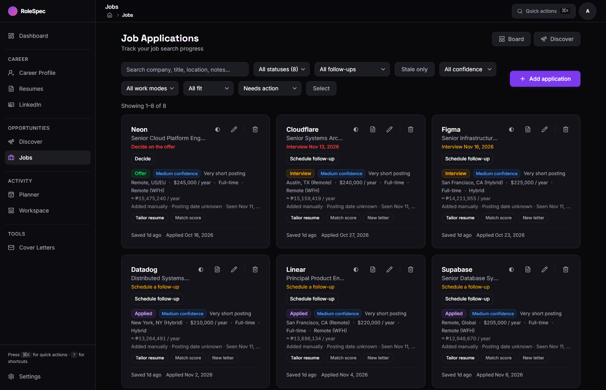

# RoleSpec OS


An open-source, single-owner job-search workspace for resumes, job discovery, applications and
outreach. Published by **Chryypt Inc**. Built with Next.js, React, TypeScript, PostgreSQL and a Tauri
Windows shell.

[Website](https://rolespec.ry0x7.dev/) · [Download for Windows](https://github.com/Ry0x7/rolespec-os/releases/latest) · [Report a bug](https://github.com/Ry0x7/rolespec-os/issues) · [AGPL-3.0-or-later](LICENSE)

## Who can use it?

- **Windows users:** the latest release targets Windows 10/11 x64 with WebView2. The installer
  bundles the app runtime and PostgreSQL 17, and creates a private database cluster on first launch;
  no Node.js, Docker or `.env` setup is needed.
- **Developers:** run your own instance with Docker or Node.js and PostgreSQL.
- **Mac/Linux:** self-hosting is available; native desktop installers are not shipped.

RoleSpec OS is a **single-owner workspace**. It launches directly into one owner workspace with no
account registration, login or password recovery. Passwordless owner access is limited to loopback
hosts; the Docker example below binds the app to localhost and sets `ROLSPEC_ACCESS_MODE=local`.
A public deployment uses `unlock` mode (the production default) and must set `ROLSPEC_ACCESS_KEY`
(16+ characters) and unlock it once; a non-loopback request is never given passwordless access.
It is not a multi-tenant service.

The Windows installer is **unsigned**, so Windows may show a SmartScreen warning. The installer
metadata names **Chryypt Inc** as the publisher, but that is an application property, not a verified
Authenticode publisher, and it cannot remove the warning. A release without `latest.json` cannot
auto-update, so newer builds are installed manually; check the release notes for a specific build.
Installation was exercised on Windows 11 x64, but not on a clean VM. See the
[desktop guide](docs/DESKTOP.md).

## What it does

- Edit master, role-family and job-tailored resumes; preview and export PDFs in eight templates.
- Import text-based PDF or DOCX resumes (up to 5 MB) without an AI provider.
- Discover opportunities and track applications, follow-ups, notes and outcomes.
- With AI configured: structure and polish resumes, analyze resume quality/job matches, and draft
  cover letters and outreach.
- Clip jobs from your browser using the standalone Chrome/Edge extension.

### Resume import and AI

Resume import defaults to **no AI**. Text is extracted on the app's server (on your computer for
Windows/local installs) and grouped by recognized heading into matching resume sections — summary,
experience with bullets, skills, education, projects and certifications — keeping the original
wording. Unrecognized headings stay editable text sections. This path does not invent employers,
roles, dates or achievements, rewrite bullets, or run ATS analysis. Scanned/image-only PDFs need OCR
before upload.

Select **Organize and polish with AI** to use a configured provider for structured import and bullet
rewriting. If you also supply a job description, RoleSpec attempts an AI job-match analysis after
saving the resume. That option sends resume text to the selected provider.

Editing and application tracking also work without AI. AI analysis and generation need a working
provider; RoleSpec does not include a managed AI service.

| AI option | Additional setup |
| --- | --- |
| Codex CLI / Claude Code | Install the vendor CLI and sign in with an eligible account |
| OpenCode free models | Install OpenCode; hosted model availability and limits can change |
| Ollama / LM Studio | Install and run a local model server |
| OpenAI / Anthropic / DeepSeek / Google APIs | Supply a provider API key; provider charges apply |

Choose and test a provider during onboarding or in Settings. CLI tools and local model servers
are not bundled. The supplied Docker configuration supports cloud API providers.

## Run it yourself

### Docker

Requires Docker with Compose.

```bash
git clone https://github.com/Ry0x7/rolespec-os.git
cd rolespec-os
cp .env.docker.example .env.docker
# Set AUTH_SECRET and ENCRYPTION_KEY in .env.docker. Compose sets
# ROLSPEC_ACCESS_MODE=local because the app port is published on 127.0.0.1.
docker compose up -d --build
```

Open [localhost:3000](http://localhost:3000). The database, migrations and export volumes are managed
by Compose. An API key is needed only if you enable AI features.

### Node.js

Requires Node.js 22+ and PostgreSQL.

```bash
git clone https://github.com/Ry0x7/rolespec-os.git
cd rolespec-os
npm install
cp .env.example .env
# Set DATABASE_URL, AUTH_SECRET and ENCRYPTION_KEY in .env.
npx prisma migrate deploy
npm run dev -- --hostname 127.0.0.1
```

Open [localhost:3100](http://localhost:3100). The owner workspace is created automatically;
seeding is optional and intended for development. See [.env.example](.env.example) for settings
and [CONTRIBUTING.md](CONTRIBUTING.md) for development commands.

### Browser extension

```bash
cd extension
npm install
npm run build
```

Load `extension/dist` through **Load unpacked** in your browser's extension settings. See the
[extension README](extension/README.md) for connection and usage details.

## Feature tour




## Privacy and deployment

Your configured database stores your career information. AI prompts leave the instance when you
choose a hosted provider; configured cloud database/export storage also stores data off-device.
Stored provider API keys are encrypted. Keep your environment files and encryption keys private.
Resume scores and opportunity-risk signals are guidance, not guarantees of interviews or proof
that a listing is fraudulent.

Use a separate private instance per person. Do not publish your personal workspace as a live demo;
use screenshots or a recording with sample data for a portfolio showcase.

## Development credits

RoleSpec OS is published by **Chryypt Inc** and developed and maintained by
[Ry0x7](https://github.com/Ry0x7).
[Claude Code](https://claude.com/product/claude-code) is acknowledged as an
AI-assisted development tool used in the project. Code decisions, review, and
maintenance remain the responsibility of the human maintainer. This credit
does not imply that Claude Code is an independent GitHub contributor or that
Anthropic endorses the project.

Human contributions are welcome; see [CONTRIBUTING.md](CONTRIBUTING.md).

## Project documentation

- [Architecture and invariants](docs/ARCHITECTURE.md)
- [Roadmap and known gaps](docs/ROADMAP.md)
- [Frontend verification and release limits](docs/FRONTEND_QA.md)
- [Windows runtime, installer metadata, troubleshooting and releases](docs/DESKTOP.md)
- [Contributing](CONTRIBUTING.md)
- [Security reporting](SECURITY.md)

Feedback from job seekers, recruiters and developers is welcome through GitHub issues. Include
installation method, reproduction steps and expected behavior; redact personal data and secrets.
