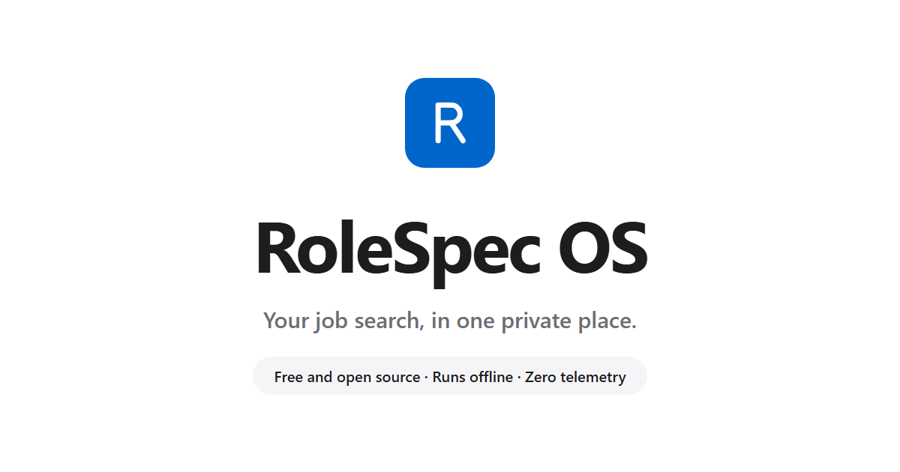
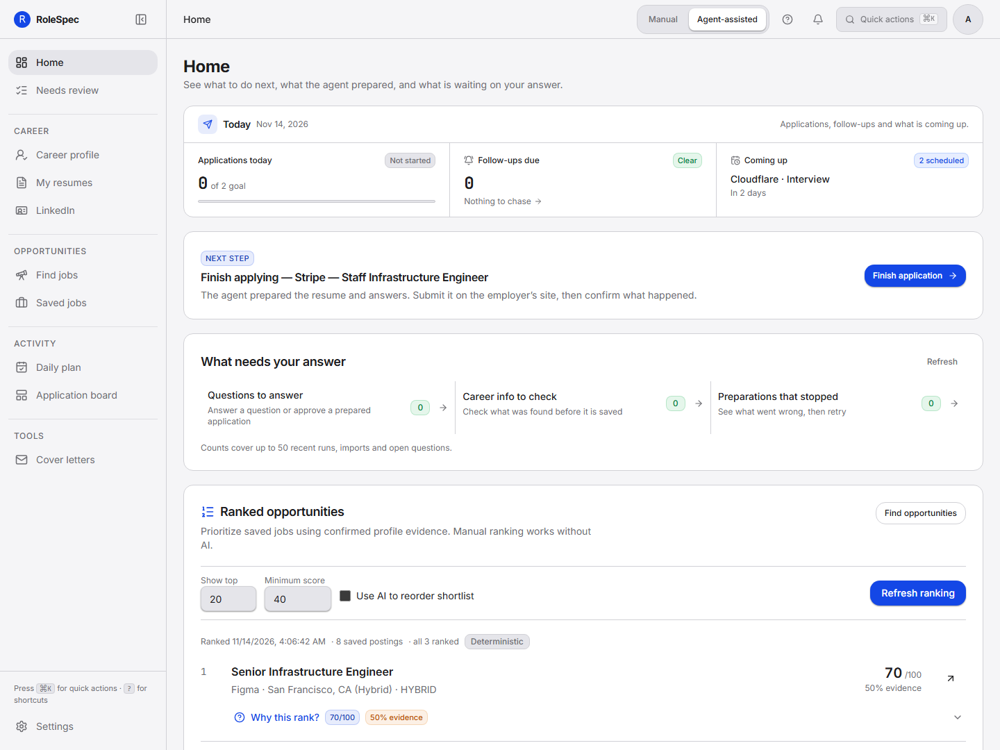
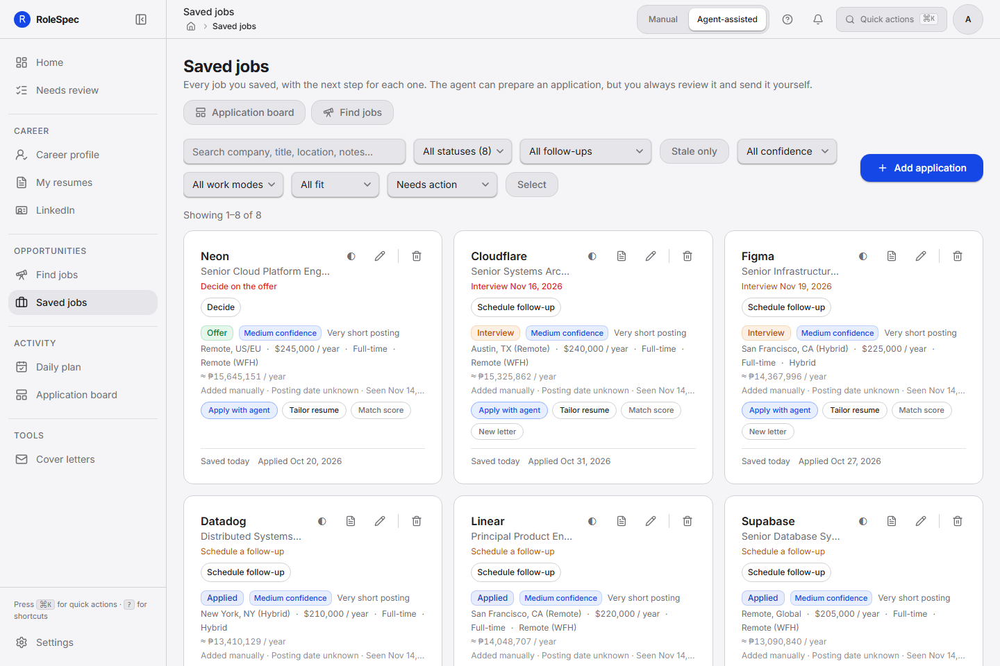
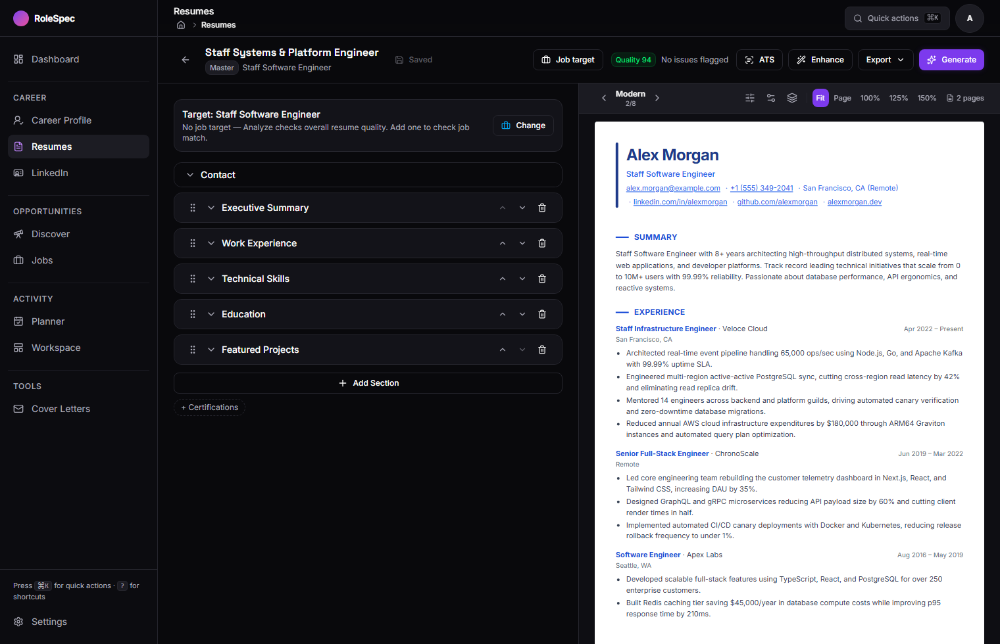
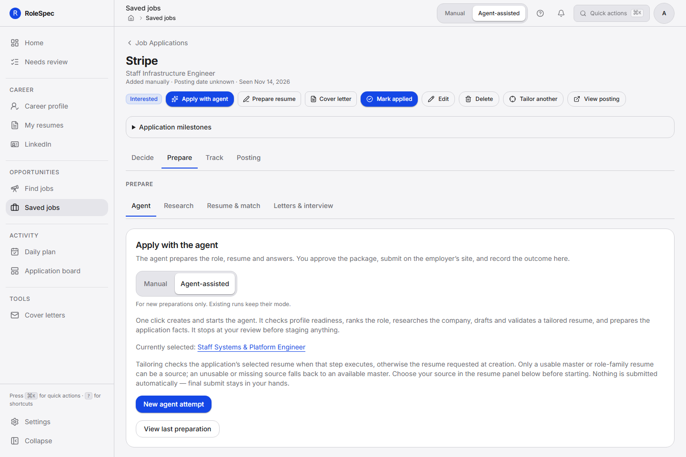
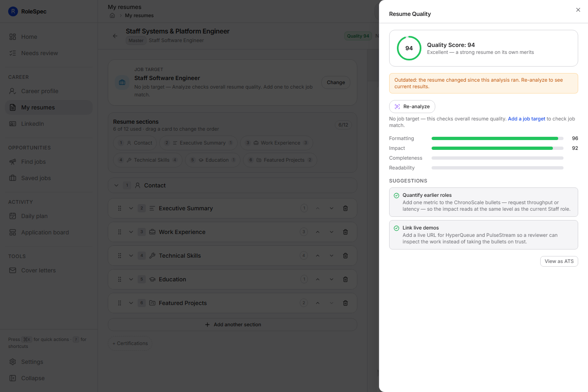
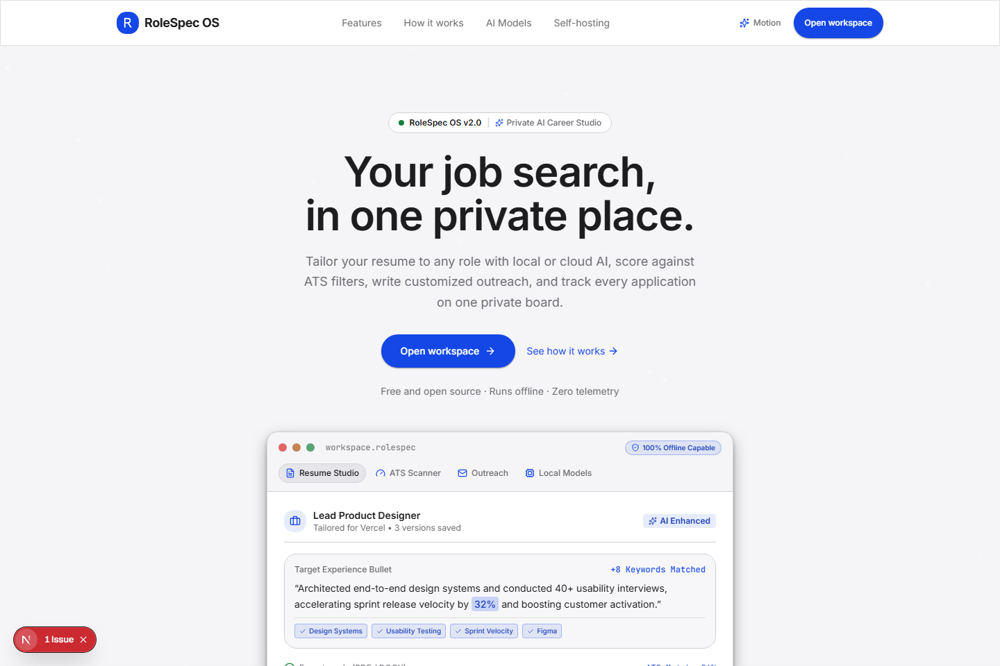

# RoleSpec OS



A private, local-first job-search workspace: resume studio, ATS matching, job discovery,
application tracking and agent-prepared applications. Published by **Chryypt Inc**.

[Website](https://rolespec.ry0x7.dev/) · [Download for Windows](https://github.com/Ry0x7/rolespec-os/releases/latest) · [Issues](https://github.com/Ry0x7/rolespec-os/issues) · [AGPL-3.0-or-later](LICENSE)

## What it is

RoleSpec OS is a **single-owner workspace**. It opens into your own data — no account
registration, shared tenancy or password recovery. It runs against a PostgreSQL database you
control; the Windows installer bundles one and sets it up privately on first launch.

AI is optional. Resume editing, importing, discovery and application tracking all work without
it. When enabled, the agent can research a company, tailor and validate a resume, prepare
application answers and assemble the package for your review. **It never submits an
application silently** — the final submit stays with you.

## Features

- **Resume studio** — master, role-family and job-tailored resumes; eight PDF templates; live preview.
- **ATS matching** — quality and job-match scores with concrete fixes and a re-analyze loop.
- **Agent-assisted apply** — research, tailor, validate, prepare ATS answers, then hand off for review.
- **Job discovery and tracking** — saved roles, applications, interviews, follow-ups and outcomes.
- **Pipeline board** — drag applications across seven statuses, with weekly goals and response stats.
- **Resume import** — text-based PDF/DOCX up to 5 MB, grouped into editable sections; no AI required.
- **Browser extension** — clip a job posting from Chrome or Edge straight into your workspace.
- **Local-first by default** — offline use, zero telemetry, encrypted provider keys.

## Screenshots

<table>
  <tr>
    <td width="50%"></td>
    <td width="50%"></td>
  </tr>
  <tr>
    <td width="50%"></td>
    <td width="50%"></td>
  </tr>
  <tr>
    <td width="50%"></td>
    <td width="50%"></td>
  </tr>
</table>

## Quick start

### Windows (recommended)

Download the [latest release](https://github.com/Ry0x7/rolespec-os/releases/latest) and run the
installer on Windows 10/11 x64. It bundles the app runtime, WebView2 and PostgreSQL 17, and
creates a private database cluster on first launch. No Node.js, Docker or `.env` setup is needed.

The installer is **unsigned**, so Windows SmartScreen may warn you. The installer names
**Chryypt Inc** as publisher, but that is application metadata, not a verified Authenticode
signature. Builds are installed manually; auto-update is not guaranteed for every release.

macOS and Linux can self-host; native installers are not shipped.

### Docker

Requires Docker with Compose.

```bash
git clone https://github.com/Ry0x7/rolespec-os.git
cd rolespec-os
cp .env.docker.example .env.docker
# Set AUTH_SECRET and ENCRYPTION_KEY in .env.docker.
docker compose up -d --build
```

Open [localhost:3000](http://localhost:3000). Compose publishes the port on `127.0.0.1` and
sets `ROLSPEC_ACCESS_MODE=local`.

### Node.js

Requires Node.js 22+ and PostgreSQL.

```bash
git clone https://github.com/Ry0x7/rolespec-os.git
cd rolespec-os
npm install
cp .env.example .env
# Set DATABASE_URL, AUTH_SECRET and ENCRYPTION_KEY in .env.
npx prisma migrate deploy
npm run dev -- --hostname 127.0.0.1
```

Open [localhost:3100](http://localhost:3100). The owner workspace is created automatically.
See [.env.example](.env.example) for every setting.

### Browser extension

```bash
cd extension
npm install
npm run build
```

Load `extension/dist` through **Load unpacked** in your browser's extension settings. See the
[extension guide](extension/README.md) for details.

## AI providers

| Option | Setup |
| --- | --- |
| Codex CLI / Claude Code | Install the vendor CLI and sign in with an eligible account |
| OpenCode | Install OpenCode; free hosted model availability and limits can change |
| Ollama / LM Studio | Install and run a local model server |
| OpenAI / Anthropic / DeepSeek / Google | Supply a provider API key; provider charges apply |

Choose and test a provider during onboarding or in **Settings → AI**. CLI tools and local model
servers are not bundled. Resume import defaults to **no AI** and keeps your original wording;
select *Organize and polish with AI* to send text to the configured provider.

## Privacy and security

Your database holds your career data. AI prompts leave the instance only when you choose a
hosted provider, and configured cloud database or export storage also stores data off-device.
Stored provider keys are encrypted. Keep your environment files and encryption keys private.

Passwordless owner access is limited to loopback hosts. A public deployment uses `unlock` mode
and must set `ROLSPEC_ACCESS_KEY` (16+ characters); a non-loopback request never receives
passwordless access. Use one private instance per person — never publish your personal
workspace as a live demo.

Resume scores and opportunity-risk signals are guidance, not guarantees of interviews or proof
that a listing is fraudulent.

## Documentation

- [Architecture and invariants](docs/ARCHITECTURE.md)
- [Roadmap and known gaps](docs/ROADMAP.md)
- [Frontend verification and release limits](docs/FRONTEND_QA.md)
- [Windows runtime, installer metadata and releases](docs/DESKTOP.md)
- [Contributing](CONTRIBUTING.md) · [Security](SECURITY.md)

## Credits

RoleSpec OS is published by **Chryypt Inc** and developed and maintained by
[Ry0x7](https://github.com/Ry0x7). [Claude Code](https://claude.com/product/claude-code) is
acknowledged as an AI-assisted development tool; code decisions, review and maintenance remain
the maintainer's responsibility. This credit does not imply endorsement by Anthropic.

Licensed under [AGPL-3.0-or-later](LICENSE). Feedback is welcome through GitHub issues; include
your installation method, reproduction steps and expected behavior, and redact personal data.
