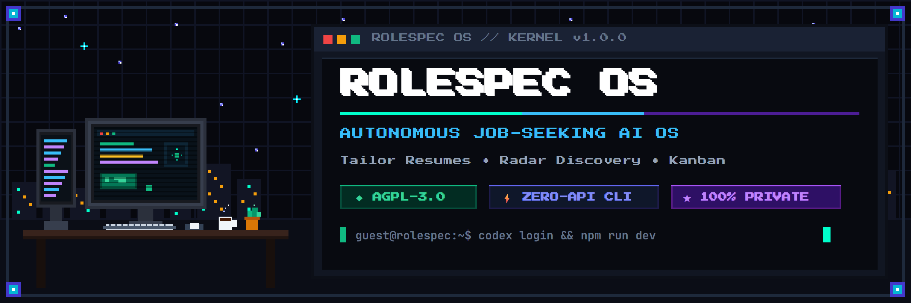
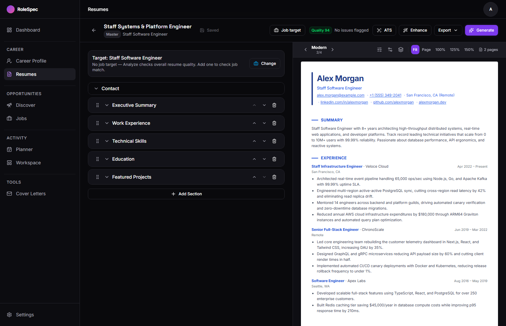
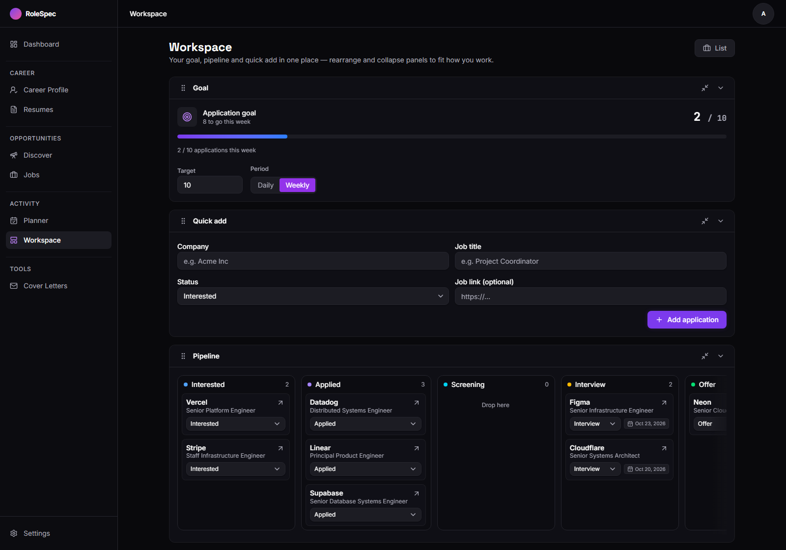
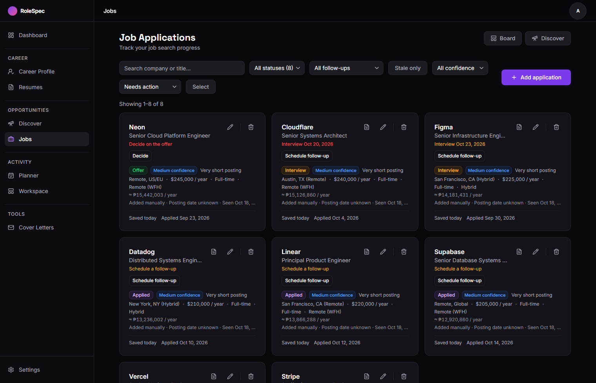

<p align="center">
  
</p>

<p align="center">
  <strong>The Autonomous, Self-Hosted Job-Seeking AI Operating System.</strong><br />
  Build ATS-tailored resumes, score job matches, track applications, and draft outreach in your private workspace.
</p>

<p align="center">
  <a href="LICENSE"></a>
  
  
  
  
  <a href="https://ko-fi.com/ry0x7"></a>
  <a href="https://github.com/Ry0x7/rolespec-os/pulls"></a>
</p>

---

## 💡 Why RoleSpec?

Job hunting shouldn't require paying $30/month across separate resume builders, ATS keyword scrapers, job tracking spreadsheets, and email outreach tools.

**RoleSpec** is an open-source, private, all-in-one desktop and web OS that combines:
- **ATS Resume Builder** with real token-matching algorithms and real-time score auditing.
- **Zero API Key AI Engine**: Use your existing **ChatGPT Plus** or **Claude Pro** subscriptions directly via CLI — no expensive per-token API credits or credit cards needed!
- **Opportunity Pipeline**: Full Kanban & table tracking with follow-up nudges, ghost-job/scam detection, and calendar agenda.
- **Application & Cold Outreach Generator**: Context-aware cover letters and cold outreach based on your verified credentials.
- **Standalone Chrome Extension (MV3)**: 1-click job clipping from LinkedIn, Indeed, Greenhouse, Lever, and Workday directly into your dashboard.

---

## ⚡ AI setup: use what you already have

RoleSpec uses AI for resume tailoring, ATS analysis, job matching, cover letters and outreach.
First-run setup asks how AI should work and tests the connection before you start. You can use a
subscription you already pay for, a local model, or a provider API key.

> **RoleSpec is not an AI-free app.** Resume editing and application tracking work without AI, but
the AI-powered features need a working provider. You choose one during setup; nothing is hidden
behind a managed AI service.

| Provider | What it uses | Cost / Setup |
| :--- | :--- | :--- |
| **ChatGPT via Codex CLI** | Your **ChatGPT Plus or Pro** subscription | **$0 extra.** Run `npm i -g @openai/codex && codex login` |
| **Claude via Claude Code** | Your **Claude Pro or Team** subscription | **$0 extra.** Run `claude setup-token` |
| **Ollama / LM Studio** | 100% offline local GPU/CPU models (Llama 3, Mistral, Qwen) | **Free forever & fully offline.** Zero internet needed. |
| **Cloud APIs (Optional)** | OpenAI (`gpt-4o`), Anthropic (`claude-3-7-sonnet`), DeepSeek, Google Gemini | Pay-per-token API keys saved securely under Settings. |

### How to use your ChatGPT or Claude subscription:

#### Option A: OpenAI Codex CLI (ChatGPT Plus / Pro)
1. Install OpenAI's Codex CLI globally:
   ```bash
   npm install -g @openai/codex
   ```
2. Log in with your ChatGPT account in your terminal:
   ```bash
   codex login
   ```
3. Set in your `.env` (or select in `/settings/ai`):
   ```env
   AI_PROVIDER=codex-cli
   ```

#### Option B: Claude Code CLI (Claude Pro / Team)
1. Generate an authentication token with Claude Code:
   ```bash
   claude setup-token
   ```
2. Set in your `.env` (or select in `/settings/ai`):
   ```env
   AI_PROVIDER=claude-code
   ```

---

## 🚀 Get started

### For job seekers (no terminal)

The intended path is a normal Windows install:

1. Download RoleSpec.
2. Install and open it — no terminal, no Docker, no Node.js, no `.env` file.
3. Complete first-run setup.
4. Choose how AI should work and test the connection.
5. Import a resume and start your job search.

**Status:** the Windows desktop installer is being built in this repository. It bundles the
application runtime and a private local PostgreSQL database, and preserves your data between
updates. It is not published yet, so there is no download link to give you today. The self-hosted
path below remains available for developers and early users in the meantime.

What first-run setup will ask for — and what it will **not** ask for:

- **It asks:** how AI should work (ChatGPT, Claude, local AI, or an API key), and whether to test it.
- **It does not ask** for `DATABASE_URL`, `AI_PROVIDER`, `OPENAI_API_KEY`, or any other environment variable.

See [`docs/DESKTOP_ONBOARDING_PROPOSAL.md`](docs/DESKTOP_ONBOARDING_PROPOSAL.md) for the desktop
architecture, database strategy and milestone plan.

---

### For developers / self-hosters

These are the supported self-hosted paths. They keep working exactly as before; the desktop build
is an additional distribution target, not a replacement.

#### Method 1: Docker (2 minutes)

You only need [Docker Desktop](https://www.docker.com/products/docker-desktop/).

1. Clone or download this repository:
   ```bash
   git clone https://github.com/Ry0x7/rolespec-os.git
   cd rolespec-os
   ```

2. Copy the Docker environment template:
   ```bash
   cp .env.docker.example .env.docker
   ```

3. Start RoleSpec:
   ```bash
   docker compose up -d --build
   ```

4. Open your browser at **[http://localhost:3000](http://localhost:3000)** — RoleSpec automatically logs you in to your private workspace.

> The container can only use cloud API providers (`openai`, `anthropic`, `deepseek`, `google`).
> CLI subscriptions and local models need a host process, so they are not available inside Docker.

#### Method 2: Node.js

**Prerequisites**
- **Node.js 22+** ([nodejs.org](https://nodejs.org/))
- **PostgreSQL** database (a free [Neon.tech](https://neon.tech) cloud database works in 30 seconds)

**Step-by-step**

1. Clone the repository and install dependencies:
   ```bash
   git clone https://github.com/Ry0x7/rolespec-os.git
   cd rolespec-os
   npm install
   ```

2. Configure your environment:
   ```bash
   cp .env.example .env
   ```
   Open `.env` and fill in:
   - `DATABASE_URL` (your Postgres connection string)
   - `AUTH_SECRET` (generate with `openssl rand -base64 32` or any random 32-character string)
   - optionally `ENCRYPTION_KEY` (recommended for stored API keys)
   - optionally `AI_PROVIDER` (`claude-code`, `codex-cli`, `ollama`, `lmstudio`, or a cloud provider)

3. Initialize your database:
   ```bash
   npx prisma migrate dev
   npx prisma db seed
   ```

4. Launch the application:
   ```bash
   npm run dev
   ```
   Open **[http://localhost:3100](http://localhost:3100)**. First-run setup now opens in the app
   instead of sending you to the settings page.

#### Method 3: Desktop shell (developer preview)

This is the runtime the Windows installer will wrap. It runs the same standalone server against a
private PostgreSQL 17 cluster, so no Docker, no user-installed PostgreSQL and no `.env` file is
needed once staged. It is Windows x64 only today, and **no installer is published yet**.

**Prerequisites**
- **Windows 10/11 x64** with WebView2 (present on Windows 11 and updated Windows 10)
- **Node.js 22+**, **Rust** (stable) and the Tauri Windows prerequisites

**Steps**

1. Install dependencies and fetch the pinned runtimes:
   ```bash
   npm install
   npm run desktop:postgres   # one-time: pinned PostgreSQL 17 binaries (~250 MB)
   ```

2. Build and stage the desktop bundle (standalone server, Node, Prisma CLI, migrations):
   ```bash
   npm run desktop:build
   ```

3. Launch the shell:
   ```bash
   npm run desktop:run
   ```

On first launch the shell creates `%LOCALAPPDATA%\RoleSpecData`, initializes the cluster, applies the
normal Prisma migrations and opens the app at `/onboarding`. Later launches reuse that cluster and
the same secrets file, so updates do not lose data or invalidate stored AI keys. It is deliberately a
*separate* directory from the per-user install location (`%LOCALAPPDATA%\RoleSpec`), so uninstalling
the app does not delete your data; remove `RoleSpecData` yourself to erase it.

| Location | Contents |
| :--- | :--- |
| `%LOCALAPPDATA%\RoleSpecData\data\pg` | private PostgreSQL cluster |
| `%LOCALAPPDATA%\RoleSpecData\data\exports` | generated PDFs and exports |
| `%LOCALAPPDATA%\RoleSpecData\config\secrets.json` | stable `AUTH_SECRET` / `ENCRYPTION_KEY` |
| `%LOCALAPPDATA%\RoleSpecData\logs` | shell, server and PostgreSQL logs |

To point the shell at an existing database instead, set `DATABASE_URL` and `AUTH_SECRET` (plus
`ENCRYPTION_KEY` if you use one) before launching. `ROLESPEC_MANAGED_DB=0` forces that mode.

Shell checks: `npm run desktop:check`, `npm run desktop:test`.

To produce the (unsigned) NSIS installer locally, after `npm run desktop:build`:

```bash
cd desktop/src-tauri
npx @tauri-apps/cli@^2 build --bundles nsis
```

The result is `desktop/src-tauri/target/release/bundle/nsis/RoleSpec_<version>_x64-setup.exe`.
It is **unsigned**, so Windows SmartScreen will warn; signing is a release prerequisite.

**If desktop startup fails**

- The error dialog names the failing step and the log file. Logs are in
  `%LOCALAPPDATA%\RoleSpecData\logs` (`desktop.log` covers the shell and server,
  `postgres.log` covers the database).
- Port 3100 in use is not fatal: the shell falls back to a free loopback port. Absolute links
  generated with the built `NEXT_PUBLIC_APP_URL` may still point at 3100 in that case.
- `DATABASE_URL` in the environment switches to an external database and requires `AUTH_SECRET`.
  Unset it (or set `ROLESPEC_MANAGED_DB=1`) to use the managed local cluster.
- To start over, close RoleSpec and move `%LOCALAPPDATA%\RoleSpecData` aside. That discards the
  database, exports and the encryption keys for any stored AI credentials; there is no undo.

---

## 📸 Feature Tour

### 🎯 ATS Scoring & Smart Resume Studio
Real Applicant Tracking Systems don't use fuzzy semantic guessing — they look for exact role competencies, measurable impact metrics, and clean typography. RoleSpec scores your resume across 5 critical dimensions and provides line-by-line Action–Result–Reason rewrites.

<p align="center">
  
</p>

- **Master vs. Job-Tailored Resumes**: Maintain your complete career history in a Master resume, and generate focused role copies tailored to specific job descriptions with one click.
- **4 Clean Export Templates**: Minimal, Modern, Harvard, and Corporate — pixel-perfect paginated PDF exports.
- **View as ATS**: Inspect the raw, unstyled text payload parser algorithms see before a human ever reads your application.

---

### 📊 Application Pipeline & Kanban Workspace
Track every lead through 7 stages: *Interested → Applied → Screening → Interview → Offer → Rejected → Archived*.

<p align="center">
  
</p>

- **Scam & Ghost-Job Detection**: Flag unrealistic compensation, suspicious external redirects, and recruitment warning signs.
- **Requirement Badges**: Automatically extracts visa sponsorship, clearance, and onsite/remote requirements from postings.
- **Follow-up Nudges**: Built-in scheduling reminds you when an application has been waiting for a recruiter reply.

---

### 🔍 Opportunity Radar & Job Board Links
Discovers jobs tailored to your career targets across LinkedIn, Indeed, Ashby, Greenhouse, Lever, Workday, and regional boards without scraping captchas.

<p align="center">
  
</p>

---

### 🧩 Chrome Extension (MV3)
Save any job description into your pipeline in 1 click, inspect eligibility requirements on the fly, and draft instant cold connection notes.

```
extension/
  ├── manifest.json       # Manifest V3 extension
  ├── src/                # Standalone Vite + TypeScript build
  └── dist/               # Load unpacked into Chrome / Brave / Edge
```

To install:
```bash
cd extension
npm install
npm run build
```
Load the `extension/dist` folder in `chrome://extensions` via **Load Unpacked**.

---

## 🛠️ Tech Stack

| Layer | Technology |
| :--- | :--- |
| **Framework** | Next.js 16 (App Router), React 19, TypeScript |
| **Styling & UI** | Tailwind CSS v4, Radix UI Primitives, Lucide Icons |
| **Motion** | Framer Motion (Smooth layout animations & gesture physics) |
| **Database & ORM** | PostgreSQL (Neon serverless or local Docker) + Prisma 7 |
| **Authentication** | Local auto-login (single-user OS), optional GitHub OAuth & credentials |
| **AI Integration** | Vercel AI SDK v7 (`codex-cli`, `claude-code`, Ollama, LM Studio, OpenAI, Anthropic, Gemini, DeepSeek) |
| **State Management**| Zustand + TanStack React Query |
| **PDF Engine** | `@react-pdf/renderer` (Paginated vector PDF generation) |

---

## 🔒 Security & Privacy Invariants

- **100% Self-Contained**: No third-party analytics, no telemetry, no tracking pixels, and no licensing server callouts.
- **Encrypted at Rest**: All personal API credentials stored in the database are encrypted using **AES-256-GCM** with keys derived from `ENCRYPTION_KEY` or `AUTH_SECRET`.
- **User Scoping**: Every resource, resume, application, and file export is strictly isolated to the authenticated account.

---

## 🤝 Contributing

Contributions from the open-source community are very welcome!

1. Fork the repository.
2. Create your feature branch (`git checkout -b feature/amazing-feature`).
3. Commit your changes (`git commit -m 'Add amazing feature'`).
4. Push to the branch (`git push origin feature/amazing-feature`).
5. Open a Pull Request.

Please run tests before submitting:
```bash
npm test
npx tsc --noEmit
```

---

## ☕ Support the Project

RoleSpec OS is 100% free, private, and open-source under AGPL-3.0. If RoleSpec saves you hours on your job search, helps you land interviews, or provides value to your career journey, consider supporting ongoing development:

<p align="center">
  <a href="https://ko-fi.com/ry0x7" target="_blank">
    
  </a>
</p>

---

## 📜 License

RoleSpec OS is licensed under the **[GNU Affero General Public License v3.0 (AGPL-3.0)](LICENSE)**.

- **You are free to**: Use, modify, self-host, and inspect this software for personal or organization use.
- **Copyleft Notice**: Any modified versions made available over a network (SaaS or hosted platforms) must release the complete source code under the AGPL-3.0.

---

<p align="center">
  Made with ❤️ by <a href="https://github.com/Ry0x7">Ry0x7</a> and the open-source community.<br />
  <strong>If RoleSpec helps your job hunt, please consider leaving a ⭐ on GitHub or supporting on <a href="https://ko-fi.com/ry0x7">Ko-fi</a>!</strong>
</p>
